# Admin Dashboard User Manual

## Purpose

This manual is for admin users who use the Camion Admin Dashboard in day-to-day work.

It explains:

- how to sign in
- how to move around the dashboard
- what each section is used for
- how to view, create, edit, and delete records
- what to check before making changes

This is a user manual, not a technical document.

## Before You Start

Make sure you have:

- a valid admin login
- permission to access the required section
- the correct data before saving any change

## Login

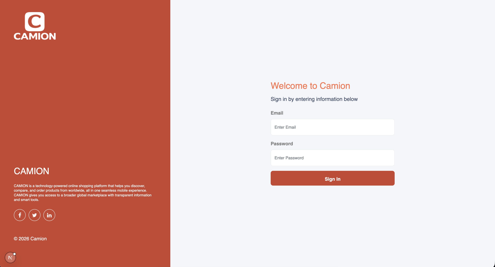

1. Open the admin dashboard login page.
2. Enter your email and password.
3. Click `Login`.
4. If login fails, recheck your email, password, and access rights.

## Dashboard Layout

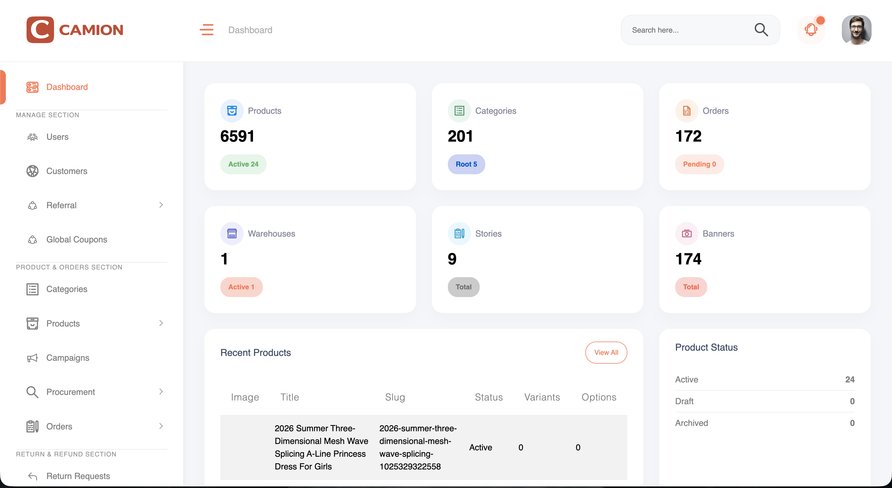

The dashboard has four main areas:

### 1. Sidebar

The left sidebar is used to move between sections.

Main groups:

- Dashboard
- Manage Section
- Product & Orders Section
- Return & Refund Section
- Misc Section

### 2. Top Bar

The top bar shows your profile area and admin header controls.

### 3. Page Content

The center area shows the selected module, list, or form.

### 4. Action Buttons

Common buttons:

- `Create`
- `View`
- `Edit`
- `Delete`
- `Refresh`
- `Apply`
- `Back`
- `Save`

## General How To Use the Dashboard

### View a list

1. Open a section from the sidebar.
2. Review the list on the page.
3. Use filters, search, or pagination if available.

### Open a record

1. Click `View` to open details.
2. Read the record carefully before making changes.

### Create a new record

1. Open the required section.
2. Click `Create`.
3. Fill in the form.
4. Check all values.
5. Click `Save` or `Create`.

### Edit a record

1. Open the list page.
2. Click `Edit` on the required row.
3. Update the fields.
4. Click `Save Changes` or `Update`.

### Delete a record

1. Click `Delete`.
2. Confirm the action in the popup.
3. Wait for success confirmation.

Delete actions should be used carefully because they can affect live data.

## Dashboard Home

### Dashboard

Use this page to quickly review:

- recent orders
- recent products
- summary counts
- activity snapshots

Use this page for quick monitoring, not detailed management.

## Manage Section

### Users

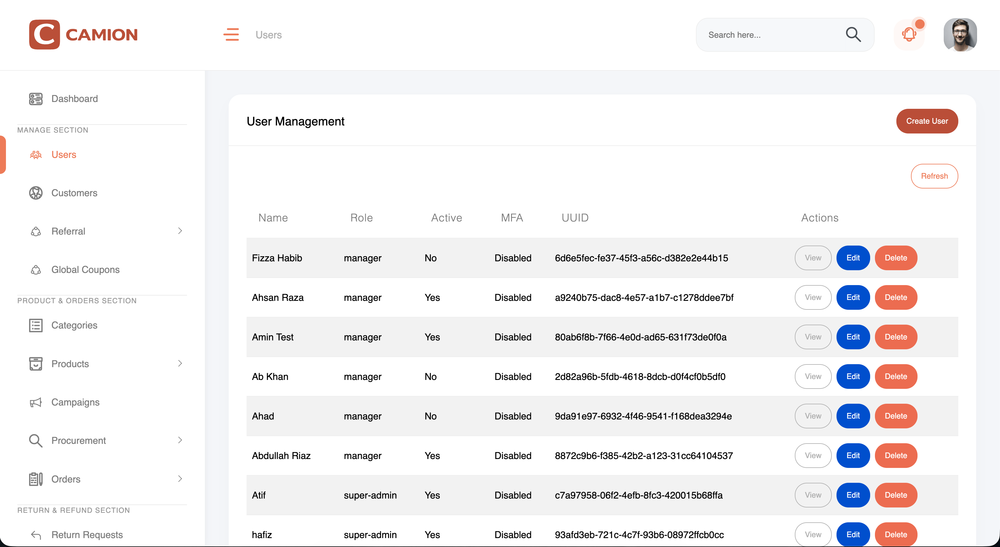Use this section to manage admin or user accounts.

Typical actions:

- view user details
- edit user information
- update role
- update status
- update password or email if allowed

Use caution when changing user roles or access.

### Customers

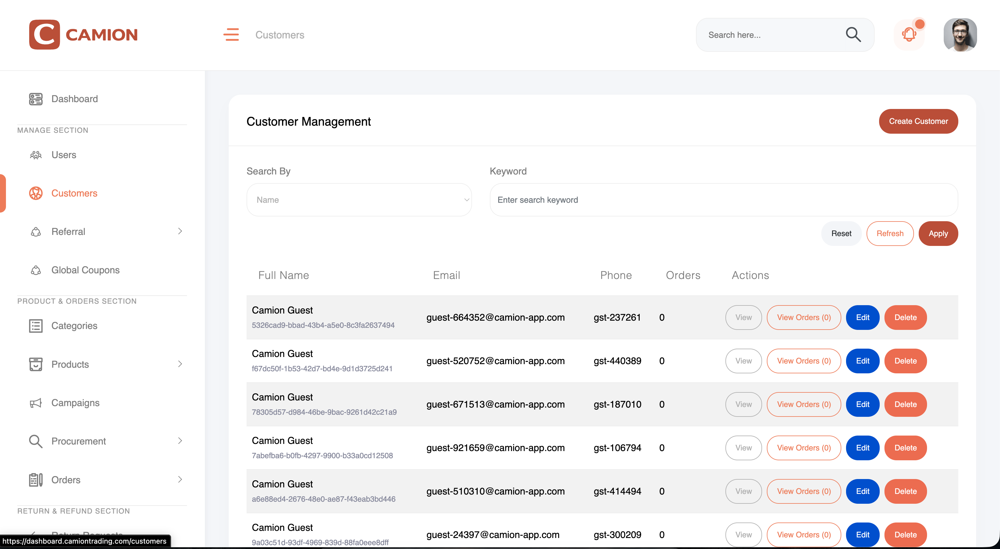Use this section to manage customer records.

Typical actions:

- search by name, email, or phone number
- view customer details
- edit customer information
- check customer UUID
- view order count
- open customer-specific orders

If you are checking a customer complaint or order history, start here.

### Referral

The Referral section contains:

- Affiliates
- Wallets
- Transactions
- Coupons

Use it to manage referral and affiliate-related data.

#### Affiliates

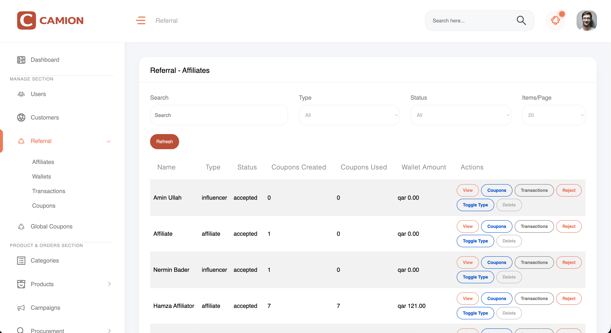Use this page to:

- view affiliate profiles
- check coupon usage
- review balances and totals
- open related wallets, transactions, and coupons

#### Wallets

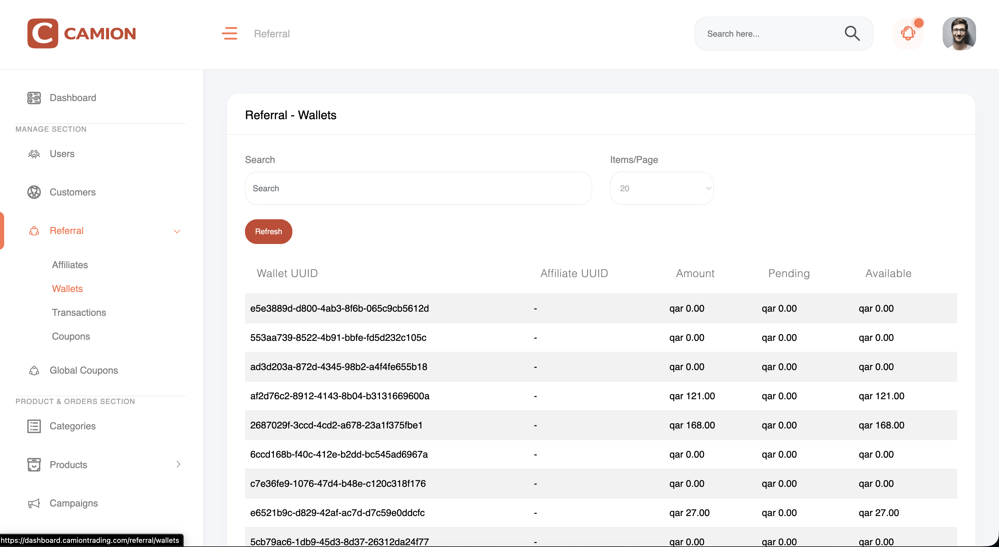Use this page to:

- view wallet balances
- monitor available and pending amounts

#### Transactions

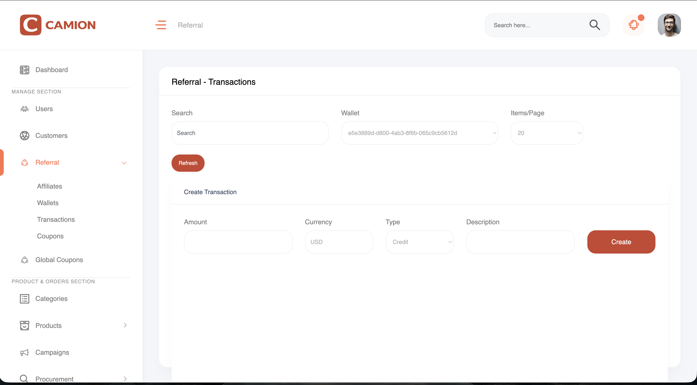Use this page to:

- view transaction history
- check transaction amounts and types

#### Coupons

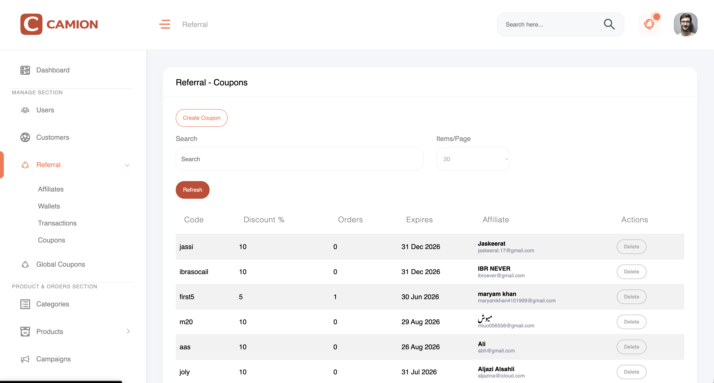Use this page to:

- view affiliate coupons
- review coupon usage
- check related affiliate information

### Global Coupons

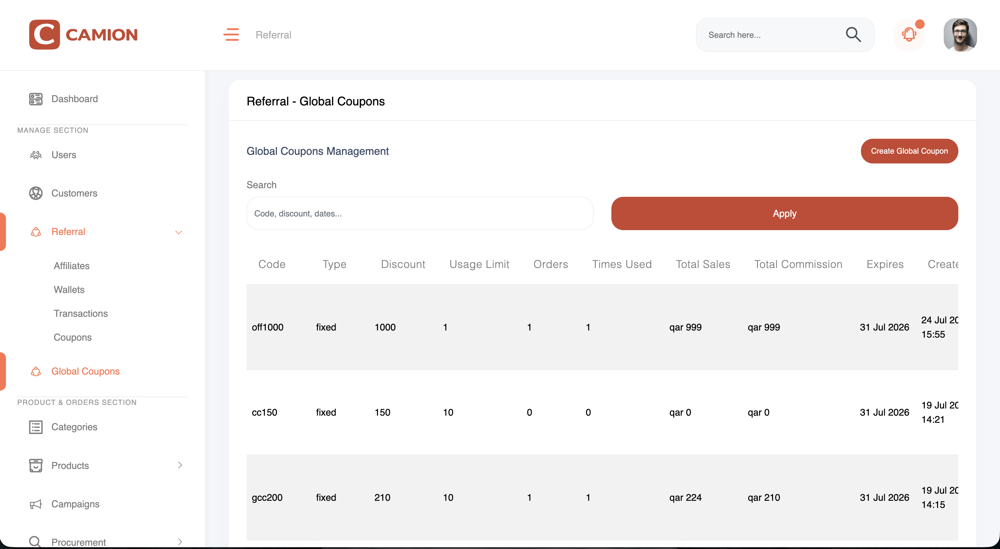Global coupons are customer-facing discount coupons created by admin.

They are not linked to any affiliate.

These coupons can be used for general promotions and can be shared with customers through:

- email campaigns
- marketing messages
- website banners
- promotional campaigns

Use it to:

- create platform-wide coupons
- set discount type
- set discount percentage or fixed value
- set usage limit
- set expiry date
- review usage count

Before saving:

- check the discount type
- confirm whether the coupon is percentage-based or fixed-value
- verify the expiry date

## Product & Orders Section

### Categories

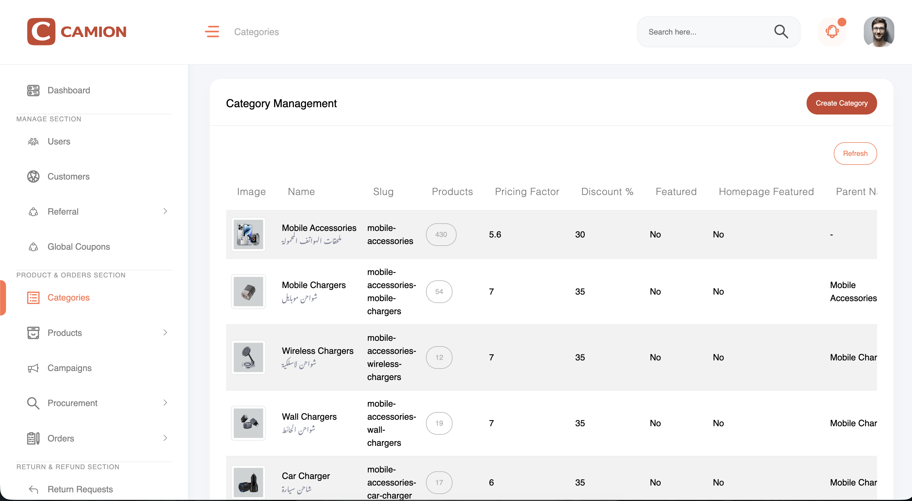Use this section to manage product categories.

Typical actions:

- create category
- edit category
- view category details
- update thumbnail
- set featured values
- check product count

Use categories carefully because they affect product organization and visibility.

### Products

- Products
- Product Reviews

#### Products

Use this page to:

- search and filter products
- view product details
- create or edit products
- manage images
- manage gallery
- manage size chart
- manage variants and options
- view procurement ID
- open 1688 product links
- trigger category resync actions where available

On product pages you may also find:

- procurement links
- review actions
- category assignment
- attachments or gallery images

`[Insert Screenshot: Product View or Edit Page]`

#### Product Reviews

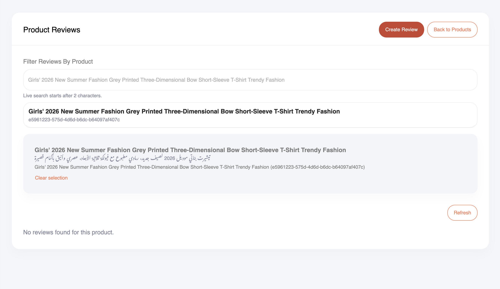Use this page to:

- view review records
- create reviews
- open individual review details

Review creation may include live product search and customer data.

### Campaigns

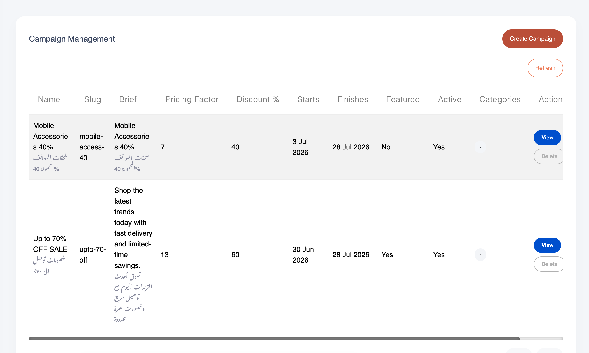Use this page to manage campaigns.

Typical actions:

- create campaign
- edit campaign
- set campaign name
- set brief
- set discount percentage
- set pricing factor
- set start and end dates
- set featured or active state
- assign categories

Before saving:

- check dates
- check discount values
- confirm category selection

### Procurement

`[Insert Screenshot: Procurement Search Listing]`

This section contains:

- Search Listing
- Create Order
- Bulk Order

#### Search Listing

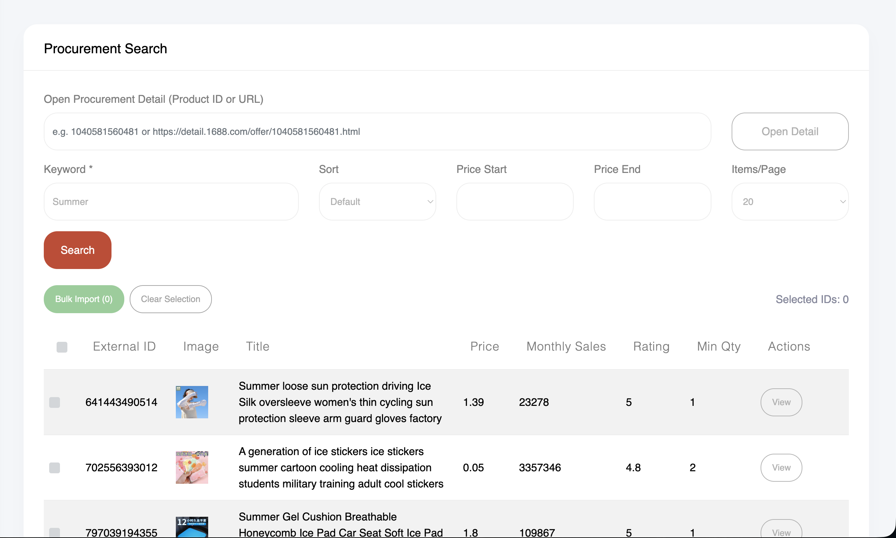

Use this page to search procurement products and inspect procurement data before importing products into your catalog.

You can use this page in two ways:

- import many searched products at once
- open one product and customize it before importing

##### Bulk import from search listing

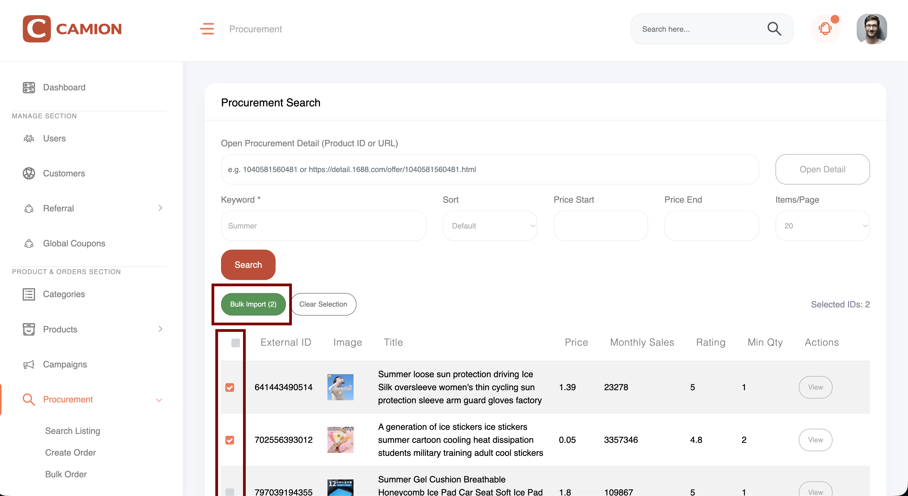Use this when you want to import multiple products together.

Steps:

1. Search for procurement products.
2. Review the search results.
3. Tick the checkbox for each product you want to import.
4. Use the import action for the selected products.
5. Wait for the import to complete.

Before bulk import:

- confirm you selected the correct products
- avoid importing duplicate or unwanted items
- verify product titles and images at a basic level

##### Single product import from procurement detail page

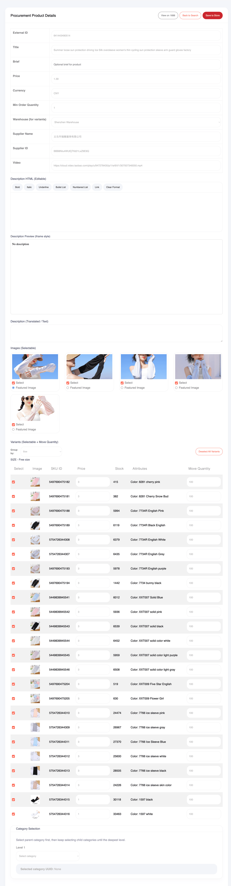.png>)

Use this when you want to review and customize one product before importing it.

Steps:

1. Open a product from the procurement search listing.
2. Go to the procurement detail page.
3. Review the product information.
4. Check the title, name, descriptions, options, and variations.
5. Choose the featured image you want to use.
6. Select which product variations you want to keep.
7. Set the stock or move quantity as needed for the selected variations.
8. Save or import the product into the catalog.

On the procurement detail page, admins may be able to review or adjust:

- product title
- product name
- product description
- images
- featured image
- variant list
- selected variations
- stock or move quantity for variations

Use this flow when the product needs checking before it is added to the store.

#### Create Order

Use this when placing a procurement order for selected items.

#### Bulk Order

Use this when ordering multiple procurement items together.

Important:

- verify procurement IDs
- verify selected variants
- check quantity before submitting
- use bulk import when many products can be added without detailed editing
- use the procurement detail page when a single product needs careful setup before import

### Orders

This section contains:

- Orders
- Dispatch Orders
- Dispatched Orders

#### Orders

Use this page to:

- view customer orders
- filter orders
- open order details
- update order status
- review invalid orders
- check customer info
- open tracking links

Order detail pages may show:

- customer information
- shipping information
- order items
- invalid item markers
- procurement links
- review shortcut buttons

Dispatch Orders

Use this page to prepare selected orders for dispatch.

#### Dispatched Orders

Use this page to review orders already dispatched and check follow-up information.

## Return & Refund Section

### Return Requests

Use this page to manage return and refund requests.

Typical actions:

- view request details
- update request status
- check reason and eligibility
- check evidence if available
- open related order

When updating status:

- verify the request first
- add notes if required
- make sure the selected status is correct

## Misc Section

### Notifications

#### Custom Notification

Use this page to manage push notifications.

Typical actions:

- create notification
- edit notification
- view notification
- upload image
- send notification
- schedule recurring notification
- schedule fixed-date notification
- stop scheduled notification

When creating a notification:

1. Enter title.
2. Enter brief.
3. Enter message.
4. Choose priority.
5. Choose schedule type if needed.
6. Upload image if needed.
7. Save.

If sending manually:

- choose the correct receiver type
- do not send scheduled notifications manually if they are already scheduled

### Warehouses

Use this section to manage warehouses.

Typical actions:

- create warehouse
- edit warehouse details
- view warehouse information
- delete warehouse if needed

### Currencies

Use this section to manage currencies used by the platform.

Typical actions:

- create currency
- edit currency
- view currency details

### Languages

Use this section to manage supported languages.

Typical actions:

- create language
- edit language
- view language records

### Exchange Rates

Use this section to manage exchange rates.

Typical actions:

- create exchange rate
- edit exchange rate
- delete exchange rate
- view rate details
- move through pages using pagination

Before saving:

- check source currency
- check target currency
- verify factor carefully

### Key Value Pairs

Use this section for system configuration entries.

Typical actions:

- create key value pair
- edit typed values
- view sensitive flag
- review value type

This area should only be changed by admins who understand the setting they are updating.

### Posts

Use this page to manage posts or content records.

Typical actions:

- create post
- edit post
- view post
- delete post

### Stories

Use this page to manage stories and story frames.

Typical actions:

- create story
- edit story
- view story
- manage media frames

### Promos

Use this page to manage promo records.

Typical actions:

- create promo
- edit promo
- view promo
- delete promo

### Banners

Use this section to manage banners shown in the platform.

Typical actions:

- create banner
- edit banner
- view banner
- upload images
- set placement
- assign categories where applicable
- update links

Before saving:

- confirm placement
- confirm image language version if applicable
- check link values
- check selected categories if used

### Export Requests

Use this section to manage export jobs.

Typical actions:

- create export request
- view request status
- update request status
- review generated file or output information

### Site Settings

Use this page to review or update dashboard-related system settings where allowed.

Change values carefully because they may affect live behavior.

## Good Admin Practice

### Before saving any change

Always check:

- correct record
- correct values
- correct dates
- correct status
- correct category or user selection

### Before deleting anything

Always confirm:

- the record is no longer needed
- it is safe to remove
- it will not affect live operations

### Before sending notifications

Always confirm:

- correct title and message
- correct audience
- correct schedule
- correct image

### Before changing order or return status

Always confirm:

- the request or order was reviewed
- the selected status is correct
- the action matches business rules

## If Something Goes Wrong

### If a page does not load

Try:

1. refresh the page
2. sign out and sign in again
3. check whether your access is still valid

### If save fails

Check:

- required fields
- invalid values
- missing selections
- date format

### If delete fails

Check:

- whether the record still exists
- whether you have permission
- whether the item is linked to other records

### If you are unsure

Do not guess on live data.

Instead:

1. stop the action
2. review the record again
3. ask the technical or product team for confirmation

## Quick Section Summary

- `Dashboard`: quick overview
- `Users`: account and role management
- `Customers`: customer records and customer-linked orders
- `Referral`: affiliates, wallets, transactions, coupons
- `Global Coupons`: platform-wide coupon management
- `Categories`: product grouping
- `Products`: product catalog and reviews
- `Campaigns`: campaign setup
- `Procurement`: procurement search and order creation
- `Orders`: order management and dispatch
- `Return Requests`: return and refund handling
- `Notifications`: push notifications
- `Warehouses`: warehouse records
- `Currencies`: currency setup
- `Languages`: language setup
- `Exchange Rates`: rate management
- `Key Value Pairs`: configuration entries
- `Posts`: content posts
- `Stories`: story media content
- `Promos`: promotional records
- `Banners`: banner management
- `Export Requests`: data export jobs
- `Site Settings`: system-level settings
